<!--
  Voce esta lendo o README cru. Bom sinal.
  Em matheusedson.com tem 21 licoes como esta escondidas em cada camada da web:
  codigo-fonte, console, cookies, headers, robots.txt, sitemap, manifest.
  Comece pelo Ctrl+U. Quem achar todas, cola os codigos em /stats.
-->

<picture>
  <source media="(prefers-color-scheme: dark)" srcset="assets/header-dark.svg" />
  <source media="(prefers-color-scheme: light)" srcset="assets/header-light.svg" />
  
</picture>

  

  
  
  
  

 

<picture>
  <source media="(prefers-color-scheme: dark)" srcset="assets/metrics-dark.svg" />
  <source media="(prefers-color-scheme: light)" srcset="assets/metrics-light.svg" />
  
</picture>

### `$ whoami`

Growth Engineer em Uberlândia, estudante de Engenharia de Computação na **UFU**. Fico no meio do caminho entre o anúncio e a receita, onde costuma vazar dinheiro: conversão que não chega no pixel, lead que cai do formulário, site que some do Google por spam injetado.

| | |
|---|---|
| 📡 **Tracking e atribuição** | GTM, GA4, Meta Pixel + Conversions API, server-side, BigQuery |
| ⚙️ **Automação** | n8n, webhooks, roteamento de lead, CRM |
| 🤖 **Agentes de IA** | orquestração com Claude Code (20+ agentes em produção), Claude API |
| 🛡️ **Segurança WordPress** | hardening por mu-plugin, resposta a incidente, limpeza de SEO poisoning |

### `$ ls ~/stack`

  

<b><code>$ cat ~/recursos.md</code></b> &nbsp;guias abertos, de graça

 

| recurso | o que resolve |
|---|---|
| [llms.txt para ChatGPT, Claude e Perplexity](https://matheusedson.com/recursos/llms-template) | site invisível para busca em IA |
| [Audit WordPress em 4 fases](https://matheusedson.com/recursos/wp-audit) | PageSpeed de 47 para 89 sem trocar tema |
| [WP Hardening por mu-plugin](https://matheusedson.com/recursos/mu-plugin-hardening) | XML-RPC, enumeração de usuário, versão exposta |
| [Checklist de SEO técnico](https://matheusedson.com/recursos/seo-checklist) | 21 itens antes de dizer que o site está pronto |
| [Detectar SEO poisoning](https://matheusedson.com/recursos/seo-poisoning-detect) | spam de cassino injetado no WordPress |

<b><code>$ cat ~/casos.md</code></b> &nbsp;o que já foi para produção

 

- **Fallback de formulário** que segurou mais de R$200 mil em leads quando o Gravity Forms falhava
- **Scanner de WordPress em 16 camadas** para achar malware e spam antes do Google
- **GEO em 280 landing pages** para aparecer em resposta de IA
- **ETL de Meta Ads + Google Ads para BigQuery**, 9 contas no mesmo painel
- **AIOS**, framework de orquestração de agentes com Claude Code

Os detalhes de cada caso estão em [matheusedson.com/blog](https://matheusedson.com/blog).

 

<a href="https://matheusedson.com">matheusedson.com</a> · Uberlândia, MG

